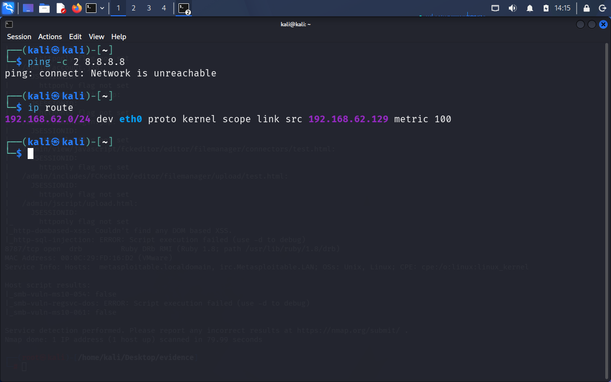
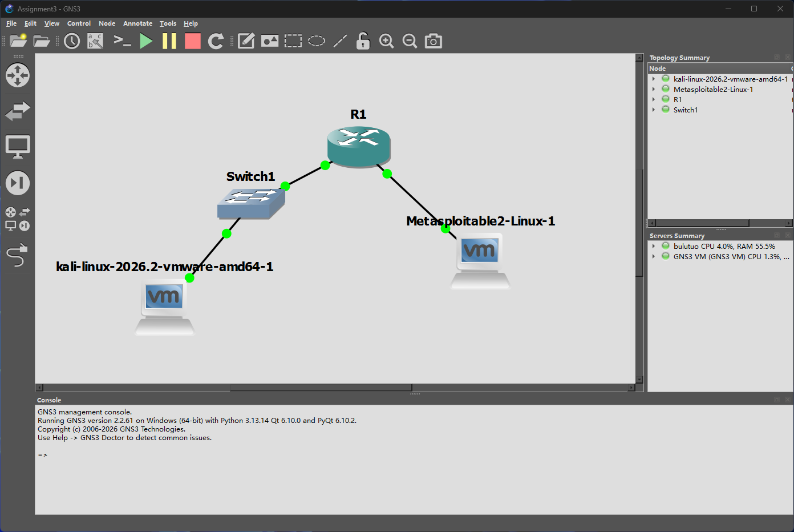
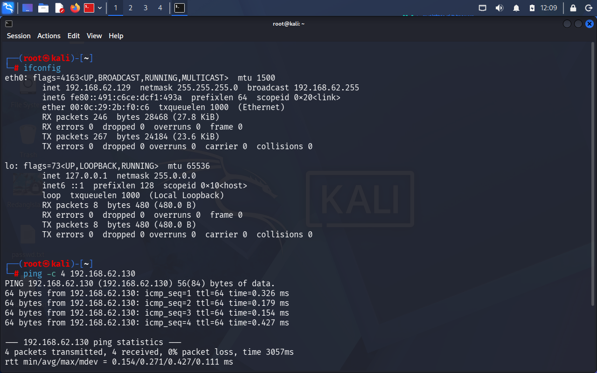
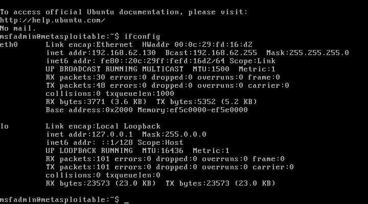
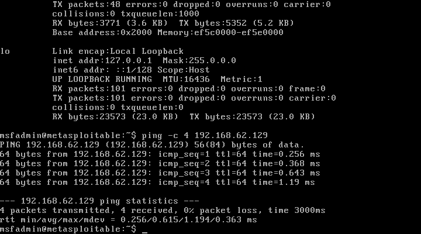

**Project 1 of 2** · [Back to the portfolio](../../)

## Objective

Build a small, isolated network on my own laptop where I can practise offensive and defensive techniques without any risk to my home network, the university network, or the internet. The lab has to be repeatable: I want to reset it to a known-clean state after every experiment, and I want the topology itself to be something I can reason about.

## Scope and authorisation

| Question | Answer |
| --- | --- |
| Who authorised the testing? | Me. Both virtual machines are mine and run on my own hardware. |
| What is in scope? | Only the guests inside the GNS3 project — in practice, the Metasploitable 2 target at `192.168.62.130`. |
| What is out of scope? | The host, the home LAN, the university network, the internet, and any address outside `192.168.62.0/24`. |
| How is that enforced? | The lab is a GNS3 project on my own machine; `Switch1` is an internal virtual switch and the only physical links are the VMware adapters that attach the guest machines. Kali has no default route, so nothing can leave the segment (proved in `evidence/01-isolation-check.png`). |

## Environment and tools

| Component | Role | Notes |
| --- | --- | --- |
| Windows laptop | Host | Runs GNS3 2.2.61 (Qt 6.10.2) and VMware Workstation |
| Kali Linux 2026.2 | Attacker / analyst machine | VMware guest, `eth0` = `192.168.62.129/24` |
| Metasploitable 2 | Deliberately vulnerable target | VMware guest, `eth0` = `192.168.62.130/24` |
| `Switch1` | Shared L2 segment | Both guests reach each other directly through this switch |
| `R1` | Router attached to the segment | Not on the path between the two guests; kept for later routing and ACL work |

The topology is deliberately flat for the first project: one segment, two guests, and a router attached to it. `R1` is not yet routing between subnets, which is why the scan in [Project 2](../nmap-service-scan/) reaches the target directly at layer 2 — the MAC address nmap reported (`00:0C:29:FD:16:D2`) is the target's own interface, not the router's.

## Method

1. Downloaded the Kali and Metasploitable 2 images and imported them into VMware Workstation.
2. Added both guests to a new GNS3 project, with `Switch1` providing the shared segment and `R1` attached to it, so the whole topology is visible and editable in one place.
3. Named the devices for what they do (`kali-linux-2026.2…`, `Metasploitable2-Linux-1`, `R1`, `Switch1`) instead of leaving the defaults, so the topology summary is readable.
4. Set the addresses inside each guest — `192.168.62.129/24` on Kali, `192.168.62.130/24` on the target — and confirmed each one with `ifconfig`, not just in the GNS3 console.
5. Proved connectivity in both directions with `ping -c 4`, so that a later scanner failure could not be blamed on the network.
6. **Proved the boundary, not just the path.** From Kali, `ping 8.8.8.8` returns `Network is unreachable`, and `ip route` shows only the `192.168.62.0/24` link route — no default gateway, so there is no route off the segment at all.
7. Took a snapshot of each guest before any testing and named it `fresh-install`, so every experiment starts from the same baseline.
8. Captured the topology view, both `ifconfig` outputs, both ping results and the isolation check as evidence, before touching either machine with a scanner.

## Results and evidence

**Outcome.** Both guests run, hold the intended addresses, and reach each other with no packet loss in either direction. The boundary is just as clear: Kali has no default route, so `ping 8.8.8.8` fails with `Network is unreachable`. That distinction matters — a timeout would have left me wondering whether something was silently dropping the packets; "unreachable" says the kernel had no route to send them in the first place. Snapshots give a repeatable baseline, and the same two machines are the subject of [Project 2](../nmap-service-scan/).

**`01-isolation-check.png`** — the isolation check. `ping 8.8.8.8` cannot even leave the host, and `ip route` holds one link route and no default gateway.

**`02-gns3-topology.png`** — the topology in GNS3: two VMware guests on `Switch1`, with `R1` attached to the same segment.

**`03-kali-address-and-ping.png`** — Kali's address, and 4/4 replies from the target at well under a millisecond.

**`04-target-address.png`** — the target's address and MAC address.

**`05-target-to-kali-ping.png`** — the reverse path replies too, so connectivity is not one-directional.

## What I would do differently

- **Check the image checksums.** I imported both images without comparing them to the published checksums. A corrupted download would have looked identical at import time and failed later, somewhere much less obvious — the check takes a minute and belongs before the first boot.
- **Run the isolation check first, not last.** It took one command, and it is the check that makes everything after it safe to do. It should have been step one, before a scanner touched the target.
- **Write the addressing plan before building.** I changed the addresses more than once because I had not written down what each machine should be.
- **Keep a lab log from day one.** Reconstructing the build order from memory took longer than a five-line log per session would have.
- **Automate the reset.** A snapshot is manual; a short script that reverts both guests to baseline would make experiments genuinely repeatable.
- **Add the router properly next time.** `R1` is attached but idle; either it should route between two subnets, or it should not be in the diagram at all.
